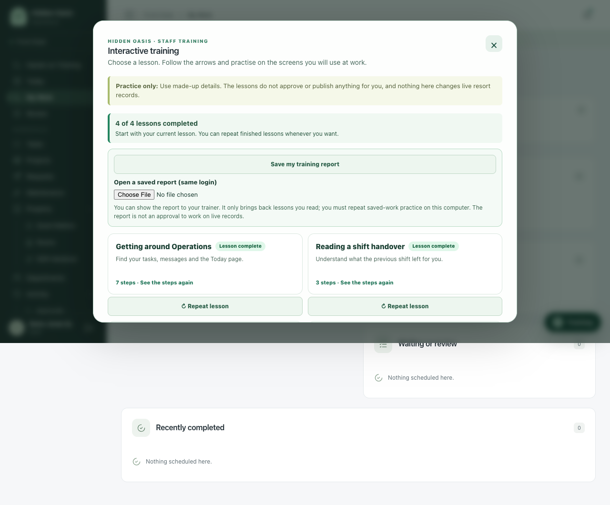
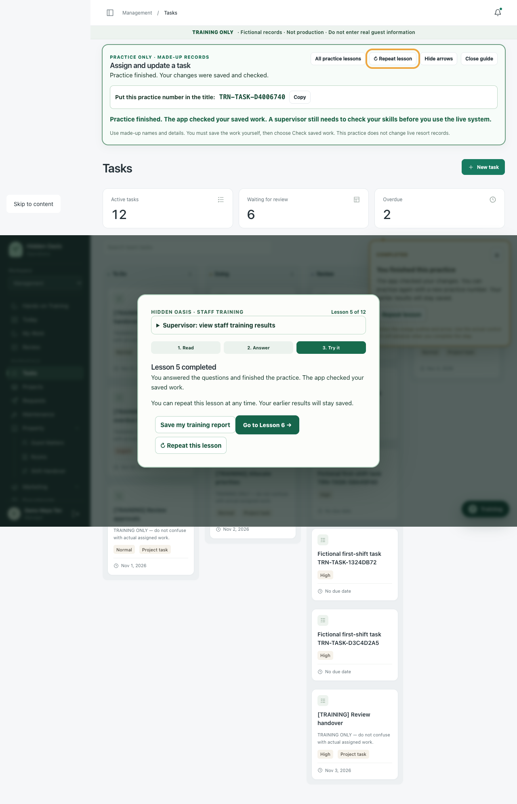

# First-time employee training walkthrough — November 2, 2026

Reviewed the current training candidate in draft PR #222, starting at `894e485380f2ebb7f73382e29092e69b5924d132` (`training/comprehensive-situations-and-assessment`). This is the 117-situation course, rather than the older training experience on `main`.

The review uses fresh fictional accounts and a new, migrated SQLite database on localhost. Existing desktop training progress, the original working checkout, live Operations, and connected business systems were not changed.

## Employee walkthrough

1. Open the login screen without an existing session. Find which account to use and what happens after signing in.
2. Sign in as a new receptionist. Read the orientation, deliberately answer a question incorrectly, correct it, and proceed into the actual Operations pages.
3. Open My Work, read a saved task's status, priority, due date and instructions, close its details, and continue the lesson.
4. Open Notifications and acknowledge a fictional personal notice. Confirm the unread count changes; acknowledgement does not complete a task.
5. Complete the four staff lessons through their teaching, quizzes, guided navigation and independent controls. Check that staff receive no record-editing privileges.
6. Repeat at a 390 px mobile viewport, including finding My Work when the navigation is closed.
7. Try written situations, correct errors, leave a partly written response, switch cases, reload and resume. Confirm the correction/hint history survives.
8. Finish the final available case, review the submitted response, repeat it, and export the previously completed response for the trainer.
9. With a fresh fictional manager, complete the first four lessons and then the task lesson. Create and assign a High-priority fictional task, move it through Doing and Review, and check each saved state against the real local backend.

The automated live walkthrough starts with no course-completion markers and no mocked API responses. The separate browser regression suite uses controlled fixtures to test error paths and permissions; those fixtures are not evidence of employee competency.

## Findings and changes

| Finding | Employee impact | Correction |
| --- | --- | --- |
| Login did not explain where fictional credentials come from | A newcomer could try a live work password or stop immediately | Explain trainer-issued accounts, Trainer Accounts, and automatic Lesson 1 |
| Required dialogs did not contain keyboard focus | Tab could move behind the lesson into unrelated controls | Focus the required lesson/resume dialog, contain Tab, and reset reading position when the screen changes |
| Long lessons had an off-screen next button without a scroll cue | A newcomer could think the lesson had no next step | Explain scrolling inside the lesson panel |
| Mobile tours targeted a hidden navigation link | No useful arrow, with a disabled Next button | Highlight Open navigation and explain how to reveal the real link; still require the employee's actual click |
| Opening or resuming a tour on another page could stall on its first required action | The highlighted control was on a page the tour never opened | Navigate to the lesson's starting page when beginning or resuming |
| A delayed navigation callback could restore an earlier step after a quick next click | The employee could be bounced back to the previous page | Cancel delayed callbacks on step changes and advance only from the matching active step |
| Filter instructions could highlight the default filter instead of the named choice | The visual pointer did not teach the intended action | Match the visible text for Urgent handovers and Guest rooms |
| Switching situations or reloading discarded the response and corrections | Lost writing; misleading attempt/hint history | Validate and save per-account, per-case drafts including stage, reasoning, attempts, mistakes and hints |
| Hints were incorrectly limited by the number of answer submissions | A valid completed case could disappear after reload | Accept independent nonnegative hint counts while retaining assisted-result flags |
| Longer guidance could put Repeat below the viewport | The button existed but could not be reached reliably | Measure popup height and constrain placement to the viewport |
| Finished situations showed only an example response | Staff and trainers could not compare the employee's own work | Retain and display the submitted note, owner and follow-up |
| A repeat could replace the last completed response | Trainer export could lose useful learning evidence | Keep the completed response separately from the current draft |
| Completing all cases looped into another case | No clear end or trainer handoff | Show an all-finished milestone and results/trainer next steps |
| Results CSV omitted the trainee and written response | Counts alone were difficult to assess | Include fictional account identity, selected choices and the completed written response; retain CSV formula escaping |
| Storage failures were silent | Employees could leave believing work had saved | Show an explicit warning while allowing in-memory practice |

The changes preserve real Operations module forms and backend permission/state contracts. They do not grant staff the ability to create, approve, verify or close work.

## Verification

The focused training workflow now also runs a real-backend employee walkthrough in CI, using a new disposable database and randomly generated fictional accounts. Browser artifacts contain fictional data only; randomized trainer passwords and private rosters are excluded.

| Check | Result |
| --- | --- |
| Final training browser regression | **79 passed**, 2 opt-in live tests skipped in this mocked run |
| Real-backend fresh employee walkthroughs | **6 passed**: both receptionist and manager flows repeated three times; no mocked API or pre-completed course state |
| Backend suite | **800 passed**, 3 skipped; the 9 socket tests blocked by the sandbox passed separately with the required local-socket permission (**809 passed in total**) |
| Local full browser inventory, accessibility and operational regression | Initial run: **647 passed**, 1 opt-in live test skipped, 4 failures. All four affected tests were corrected and passed in the final training regression. The entire broad suite was not repeated after those training fixes. |
| Frontend build, lint and TypeScript | **PASS**; standalone assets packaged; lint has no warnings |
| Operations module/API source parity | **PASS** for the same paths guarded by training CI; no business workflow/backend source changed |
| CI workflow syntax/isolation checks | **PASS**; the added live job creates its own temporary training database and private fictional roster |

Local browser verification used Chrome on this Mac. Windows installer execution and release signing/notarization were not performed.





## Remaining improvements and acceptance

- **Desktop distribution:** Rebuild the Mac and Windows installers from the accepted candidate. Signed/notarized release and ordinary employee-device launch, offline restart and progress retention still require the physical-device acceptance described in `TRAINING_DESKTOP_DEVICE_ACCEPTANCE.md`. A browser run is not an installer acceptance test.
- **More practical workflow coverage:** The 117 situations assess written choices; six saved-record exercises cover a smaller set of actions. Add further observed exercises for the authorized approval decision, implementation and receiving-shift acknowledgement if these are required for a job. Do not describe all 117 situations as verified practical execution.
- **Cross-department receipt:** The existing guest-to-fix flow inherits the guest record's department. Training should continue to describe that behavior accurately; a separate operational change would be needed to establish and verify Maintenance's receipt of a cross-department handoff.
- **Trainer assessment:** Local responses, JSON reports and CSV exports are editable learning history. A trainer must observe the employee's work and assess whether their notes and decisions are useful; matching words is not a competency certificate.

## Reproduce the live walkthrough

Use only a new disposable training database initialized by the guarded seeder. Start the backend at `127.0.0.1:8407`, then build/serve the training frontend at `127.0.0.1:3407` with `NEXT_PUBLIC_TRAINING_MODE=true` and `OPERATIONS_API_ORIGIN=http://127.0.0.1:8407`.

From `frontend`, set `TRAINING_WALKTHROUGH_ROSTER` to that disposable database's private synthetic roster, then run:

```sh
npx playwright test --config=playwright.training-live.config.ts
```

Use `PLAYWRIGHT_USE_SYSTEM_CHROME=true` when using an installed Chrome instead of Playwright Chromium. The test refuses a non-local page, does not print passwords, and disables traces for the credential flow. The live tests are skipped in the ordinary mocked browser suite unless the explicit private-roster environment variable is present.

## Plain-language follow-up

The wording review covers lesson instructions, course explanations, all 117 situations, feedback, form guidance, saved-work instructions, downloads and the trainer report view. It uses short sentences and names the next action. Button and status names stay the same as the app. Trainer reports show lesson names and clear progress labels instead of internal lesson IDs.

| Earlier wording | Employee-facing wording |
| --- | --- |
| Validate the persisted Review state | Close the details and choose Check saved work. Its saved status should be Review. |
| Document budget, quotation status and operational reason | Write the cost, quote details and reason. |
| Assign an actual fictional teammate | Choose who will do the job. |
| Write concrete fictional actions, ownership and follow-up | Write what happened, who should act next and what they need to check. |
| Save my results (CSV) | Save my results — Give this spreadsheet file to your trainer. |

The cases remain practice exercises. Safety instructions, permissions, required saved statuses and approval rules are preserved.

The wording follow-up passed 23 focused checks covering all six saved-work exercises, trainer reports, form guidance and the 117 model answers. Both fresh-account real-backend walkthroughs passed again with the simpler text. Frontend build, lint and TypeScript also passed. The earlier functional commit (`0ddcd08`) passed every required GitHub check, including full browser regression and Mac/Windows packaging; the updated wording is sent through those same checks in the PR.

GitHub subsequently completed the full browser/accessibility suite on functional commit `0ddcd08`: **654 passed, 2 opt-in skips** ([CI run](https://github.com/moraledacaryl-dev/operations-command-center/actions/runs/41440448920)). The final plain-language completion screens were captured after both real-backend walkthroughs passed again.
